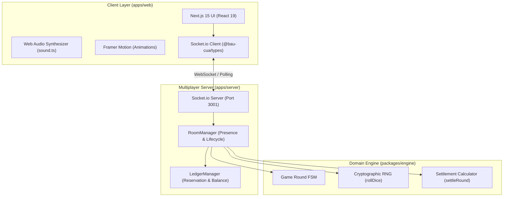
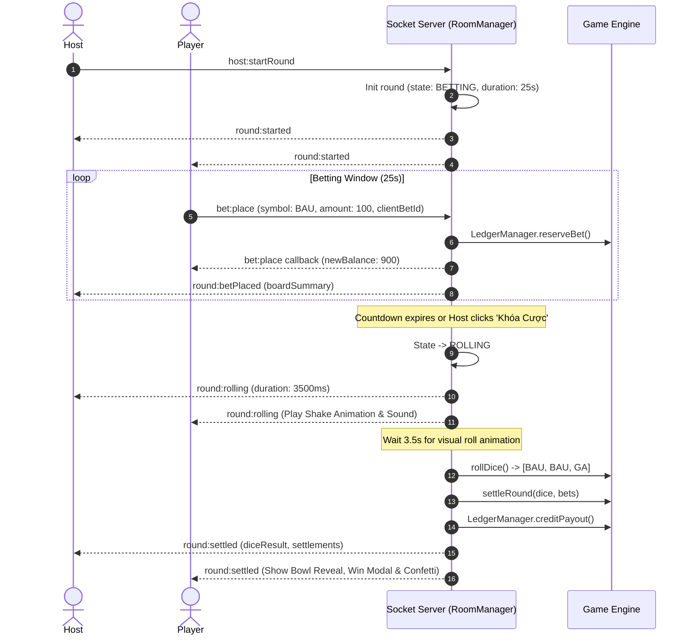

# System Architecture — Bầu Cua Online

## 1. High-Level Architecture Overview

---

## 2. Round Lifecycle State Sequence

---

## 3. Host Migration Strategy
If the active Host disconnects or leaves:
1. Socket server detects `disconnect` or `room:leave`.
2. `RoomManager.leaveRoom()` identifies if the leaving player is the room host.
3. The server queries the oldest remaining active player in `room.players`.
4. The remaining player is promoted to Host (`isHost: true`).
5. Server emits `room:hostChanged` to all remaining clients in the room.
6. The new host UI immediately gains round start and lock controls.
